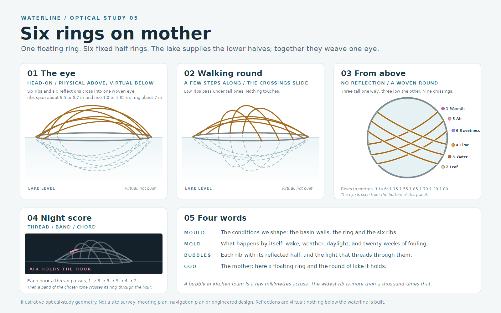

# WATERLINE

Six threads woven over open water. Each ring keeps its own line, none touches another, and together they read as one form. The lake completes them, and on calm water the weave opens into a portal on what we share.

**Current study: v0.5, Six Rings on Mother.** WATERLINE is an unbuilt concept for Toronto’s Harbour Square Park Basin, not a commissioned installation, a site survey, or an engineered design. Each arch is the outline of a bubble in the foam on a kitchen jar, more than a thousand times life size. The mother is the disc that grows on top of a jar of fermenting tea and is passed from kitchen to kitchen; here it is a floating ring and the lake inside it, and the basin is the jar. The one-rib, three-rib, first six-rib and nine-dome studies are archived, and their power, cost and structural assumptions do not establish feasibility for this form.

## Try it offline

Open the [3D basin companion](simulators/basin.html) for the revision 4 installation on simulated water. Switch between shore, oblique and overhead views, scrub the 24-hour timeline or play a compressed cycle. The opening dusk scene shows an example Water and Air chord. Tap values to queue simulated participant choices, then begin the next hour to see the thread and its result. Scrubbing previews hours without spending queued choices. The shoreline and lighting are illustrative. The companion includes Three.js 0.160.1 and its [upstream licence](simulators/vendor/three-LICENSE.txt).

Open [index.html](index.html) from the downloaded folder in a browser. No install or internet connection is required; the HTML pages work as local files with JavaScript enabled. The v0.5 study includes viewpoint, simulated water conditions, day/night, simulated choices among the six values with chords, and optional audio. The archived nine-dome and three-rib studies still run. The website preview on GitHub may display HTML as source; use the downloaded files.

If your browser blocks local files, run `python3 -m http.server 8000 --bind 127.0.0.1` from this directory and open `http://127.0.0.1:8000/`. The server is optional and stays on your device.

## Work with an AI collaborator

Start with the [public WATERLINE repository on GitHub](https://github.com/realsammyt/waterline).

Give your agent the repository and one question, such as “Which assumptions most affect the battery size?” If it can’t open GitHub, download the repository ZIP, extract it, and open that folder in your agent’s workspace. When reviewing a proposed change, include its pull request link so your agent reads the same revision.

Copy this prompt and replace the question in brackets.

> Read the public WATERLINE repository at https://github.com/realsammyt/waterline, or use the local checkout I provided. My question is [replace this with your question]. Start with HANDOFF.md for project status, then read AGENTS.md and README.md. Use docs/rings-on-mother.md for the current v0.5 design. For dimensions or power assumptions, check models/gen_rim.py. For what the visualizer actually does, check simulators/basin.html, basin.js and basin-scene.js in the simulators folder. Tell me which branch or commit you reviewed. Cite the file and section behind each finding, distinguish estimates from measurements, and flag anything the team still needs to decide. Suggest one practical next step I can bring back to the team.

Share the answer with the team along with its source references and any proposed test. For edits, follow [the contribution guide](CONTRIBUTING.md).

## Read the studies

- [v0.5 concept, theme response and night score](docs/rings-on-mother.md)
- [Prototype and design basis](docs/prototype.md)
- [Shore, web and event participation](docs/interaction.md)
- [Earlier optical studies and concept art](docs/archive.md)
- [Public commission context](docs/context.md)
- [Contributing and review](CONTRIBUTING.md)

The simulators use illustrative geometry, synthetic weather presets and generated tones. They use no sensors, live data, remote services, or equipment connections. Nothing here connects to an artwork. The v0.5 proposal lets the public choose which ring glows each hour; that choice never reaches the separate safety systems.
