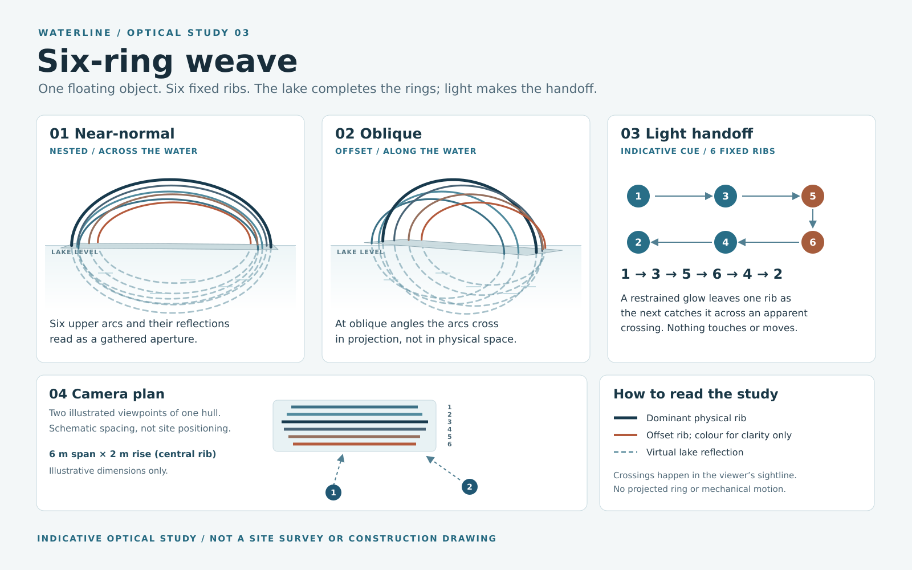

# WATERLINE

Six fixed arcs share one floating structure. The lake supplies the lower halves. From one stretch of shore the arcs gather into a shared opening; move sideways and they separate. A wake breaks the rings and makes room for them to return. After dark, a restrained ember passes between ribs without turning them into one band of light.

**Current study: v0.3, Six Ring Weave.** WATERLINE is an unbuilt concept for Toronto’s Harbour Square Park Basin, not a commissioned installation, a site survey, or an engineered design. The one- and three-rib studies are archived, and their power, cost and structural assumptions do not establish feasibility for six ribs.

## Try it offline

Open [index.html](index.html) from the downloaded folder in a browser. No install or internet connection is required; the HTML pages work as local files with JavaScript enabled. The v0.3 study includes viewpoint, simulated water conditions, day/night and an optional audio handoff. The earlier three-rib study includes simulated shore and event cues. The website preview on GitHub may display HTML as source; use the downloaded files.

If your browser blocks local files, run `python3 -m http.server 8000 --bind 127.0.0.1` from this directory and open `http://127.0.0.1:8000/`. The server is optional and stays on your device.

## Read the studies

- [v0.3 concept and light score](docs/six-ring-weave.md)
- [Prototype and design basis](docs/prototype.md)
- [Shore, web and event participation](docs/interaction.md)
- [Earlier optical studies and concept art](docs/archive.md)
- [Public commission context](docs/context.md)
- [Contributing and review](CONTRIBUTING.md)

The simulators use illustrative geometry, synthetic weather presets and generated tones. They use no sensors, live data, remote services, or equipment connections. The public cannot control the physical artwork or its separate safety systems.
