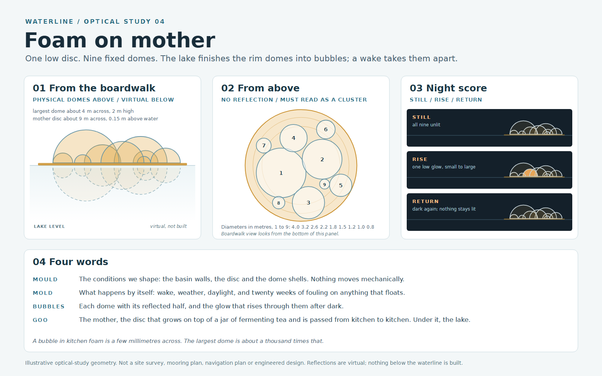

# WATERLINE

The foam on a kitchen jar, at the size of a harbour. Nine fixed translucent domes crowd together on one low amber disc, and the lake supplies their lower halves. From one stretch of shore the domes stack into a single mound; move sideways and they open into separate bubbles. A wake breaks the bubbles and makes room for them to return. After dark, one low glow rises from the smallest dome to the largest and goes out.

**Current study: v0.4, Foam on Mother.** WATERLINE is an unbuilt concept for Toronto’s Harbour Square Park Basin, not a commissioned installation, a site survey, or an engineered design. The disc is the mother, the disc that grows on top of a jar of fermenting tea and is passed from kitchen to kitchen; here it is the float, and the basin is the jar. The one-, three- and six-rib studies are archived, and their power, cost and structural assumptions do not establish feasibility for this form.

## Try it offline

Open [index.html](index.html) from the downloaded folder in a browser. No install or internet connection is required; the HTML pages work as local files with JavaScript enabled. The v0.4 study includes viewpoint, a view from above, simulated water conditions, day/night and an optional audio cue. The archived six-rib and three-rib studies still run. The website preview on GitHub may display HTML as source; use the downloaded files.

If your browser blocks local files, run `python3 -m http.server 8000 --bind 127.0.0.1` from this directory and open `http://127.0.0.1:8000/`. The server is optional and stays on your device.

## Read the studies

- [v0.4 concept, theme response and night score](docs/honey-foam.md)
- [Prototype and design basis](docs/prototype.md)
- [Shore, web and event participation](docs/interaction.md)
- [Earlier optical studies and concept art](docs/archive.md)
- [Public commission context](docs/context.md)
- [Contributing and review](CONTRIBUTING.md)

The simulators use illustrative geometry, synthetic weather presets and generated tones. They use no sensors, live data, remote services, or equipment connections. The public cannot control the physical artwork or its separate safety systems.
